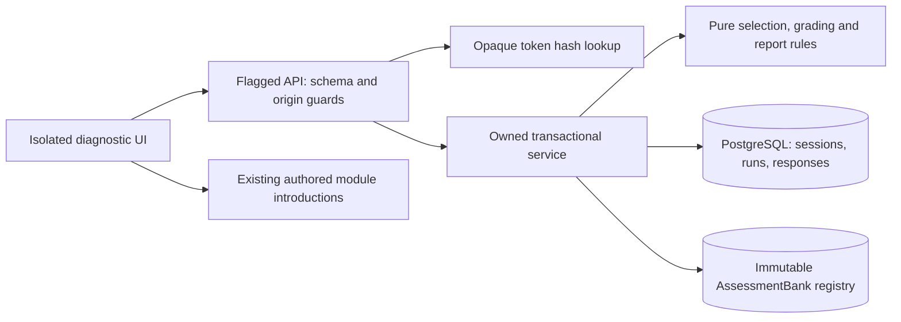

# System architecture and local operation

Keep a modular Next.js/PostgreSQL monolith. No new runtime dependency, microservice or arbitrary-code execution service is introduced.



## Boundaries

- `diagnostic/types.ts`: serializable contracts only; client imports are type-only.
- `python-bank.ts`: original Python content and private answer keys, imported by server services and tests only. A pinned checksum test detects accidental edits. The learning server page reads existing Python module content and renders only explanatory prose.
- `engine.ts`: strict input schema, deterministic grading, next selection, evidence summaries and learning ordering.
- `service.ts`: token lifecycle, bank publication/snapshot verification, owned run lookup, locks, response/draft/hint persistence and report sealing.
- `/api/diagnostic-v2`: runtime flag, private no-store responses, Origin/Host check, strict 8 KiB streaming body limit and validation; no learner IDs, tokens, keys or full banks in public state.
- `diagnostic-experience.tsx`: INTRO/RESUME/QUESTION/FEEDBACK/COMPLETED presentation plus derived answer-selected/submitting/error/hint states. Component-local busy state always clears in finally. Bounded fetch timeout permits recovery. CSS Module scopes the new design away from existing screens.

## Persistence and request lifecycle

Enter creates a normal User and a dedicated DiagnosticSession holding only SHA-256 of a random 256-bit bearer token, with 30-day expiry. The token travels only in an HttpOnly SameSite=Strict cookie (Secure over HTTPS). Session creation is not an account, identity proof or multi-device login.

Start locks the session row, resumes an existing active run or returns the latest report. Explicit restart creates a new run after completion and can route from prior unresolved findings. New content is upserted without updates into AssessmentBank and compared to its digest; conflict requires a new version. A run snapshot preserves content and engine policy. Starting this pilot does not change selected role on existing legacy users: it creates its own user/session.

Read uses `(sessionId, id)` or latest indexed `(sessionId, startedAt)`, loads at most 30 responses and returns only the current question projection, draft, hint if requested, most recent feedback and final report if completed. No answer history/keys are sent during testing. Run bookmarks still require the owning session cookie.

Answer authenticates, validates one modality, then locks the owned run row. Exact replays return stored state; changed replays fail. New evidence, selection rationale/current item and report/status commit in one transaction. Drafts and hints lock the same row and reject stale question IDs; they cannot rewrite submitted evidence. GET then reconstructs a safe state after disconnect. Local drafts plus a 650ms debounce reduce request volume. Local storage is browser convenience; the server is authoritative for submitted answers and assisted flags.

## Schema changes

`202610270001_adaptive_diagnostic`: three new tables, unique token hash, unique `(runId,questionId)` and `(runId,position)`, indexed session/run chronology, restrictive run/session FKs.

`202610270002_diagnostic_session_owner`: explicit existing User foreign key. Kept separate after the first additive migration was exercised locally; no applied migration was rewritten.

Existing three migrations and published legacy content remain untouched. Migration-preservation tests repeat migration/seed and check legacy records. No new seed is necessary for the bank; start publishes it immutably. Hosted builds retain existing no-write behaviour.

## Run the pilot locally

```sh
npm ci --ignore-scripts
# Configure ignored .env with your local PostgreSQL DATABASE_URL.
npm run setup
DIAGNOSTIC_V2_ENABLED=true npm run dev
```

Visit `/diagnostic-v2` on the server's localhost origin. On Windows set the environment variable through PowerShell before starting npm. Use `.env.test` with a distinct TEST_DATABASE_URL for tests. Never point verification at production/shared databases.

In this cloud environment the existing local PostgreSQL helper is `/workspace/skillsetu-runtime/start-postgres.sh`; socket commands require network-enabled execution. A workspace localhost URL does not become reachable from the user's computer automatically. Screenshots are provided as review artifacts; no production deployment was made.

For a production-equivalent local build, `npm run build`, then `DIAGNOSTIC_V2_ENABLED=true npm start -- --port 3005`. Run additive migration only against an explicitly confirmed local database. Public deployment must keep the flag off until authentication, abuse controls and content/release gates are complete.
